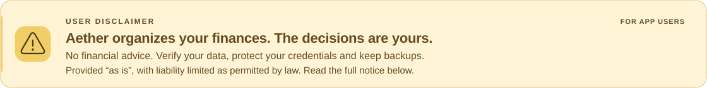
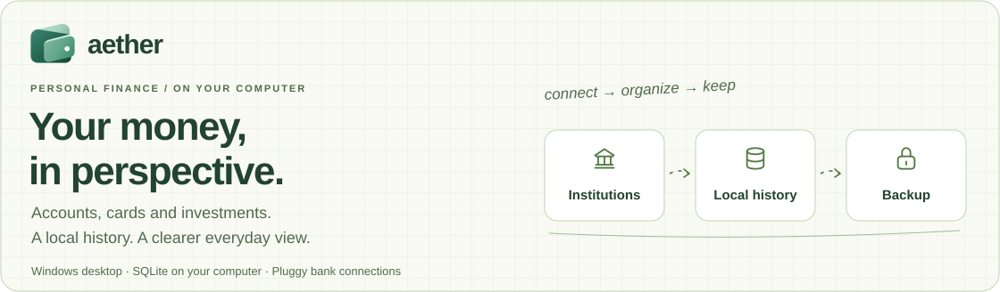
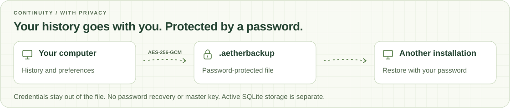

<div align="right">

**English** · [Português (Brasil)](README.pt-BR.md)

</div>

<a href="#user-disclaimer">
  <picture>
    <source media="(prefers-color-scheme: dark)" srcset="docs/images/aether-disclaimer.en.dark.svg">
    
  </picture>
</a>

<div align="center">

<picture>
  <source media="(prefers-color-scheme: dark)" srcset="docs/images/aether-hero.en.dark.svg">
  
</picture>

[](https://github.com/LuizGabe/Aether/releases/latest)
[](https://github.com/LuizGabe/Aether/releases)
[](LICENSE)

**Accounts, cards and investments. A clearer view of your finances, on your own computer.**

[Download](https://github.com/LuizGabe/Aether/releases/latest) · [Getting started](#download-and-get-started) · [Development](#development) · [License](LICENSE)

</div>

## Clarity for everyday finances

Aether brings your financial history together in a Windows desktop app. Current accounts, credit cards and investments each have their own place, so balances, limits and spending make sense in the same view.

Imported data stays in a local SQLite database. Browse your history offline, review transaction details and organize categories, rules and recurring payments without keeping a browser tab open. Connecting and syncing institutions requires internet access and Pluggy.


<sub>Interface illustration in Portuguese. All amounts are fictional; no real banking data was used in this README.</sub>

## What you can do

| Area | What it helps you do |
|---|---|
| **Overview** | Track balances, income, spending and institutions in one place. |
| **Accounts** | Understand available funds and review cash flow. |
| **Cards** | Separate used credit, statements, purchases and payment accounts. |
| **Investments** | Review holdings and activity as provided by your institution. |
| **Transactions** | Search, filter, export and review descriptions, categories and movement types. |
| **Time of day** | See available transaction times with sun and moon markers. |
| **Recurring activity** | Recognize patterns and add meaningful names and images. |
| **Settings** | Manage connections, products, categories, rules, backups and preferences. |

Results depend on the institution's coverage and update frequency. Missing fields are identified; Aether does not invent merchants, timestamps or investment holdings.

## Download and get started

1. Open the [latest release](https://github.com/LuizGabe/Aether/releases/latest).
2. Download **`Aether-v0.2.0-windows-x64-setup.exe`** and run the installer.
3. Open Aether from the Start menu. Pin it to the taskbar if you like.
4. Set up your connections or restore an existing backup.

**The installer includes Java 21 and the offline Microsoft WebView2 installer.** You do not need to install Java, Node.js, Maven or Rust to use the app.

Bank setup requires internet access, a Pluggy application and the account holder's authorization through the official bank/Meu Pluggy flow. Enter credentials in the app; they are stored in Windows Credential Manager. They are not bundled with the download or included in backups.

> GitHub's automatic **Source code (zip/tar.gz)** archives contain the source code. To install the app, choose the **`-setup.exe`** file. Download access follows the repository's permissions, including when it is private.

This version's installer does not have a code-signing certificate. Read the release notes and verify `SHA256SUMS.txt` before installing.

[Full setup tutorial — Portuguese →](docs/tutorial-primeiro-acesso.md)

## Your history, protected and portable

<picture>
  <source media="(prefers-color-scheme: dark)" srcset="docs/images/aether-backup.en.dark.svg">
  
</picture>

Under **Settings → Data and backup** (*Configurações → Dados e backup*), export your history as a **password-protected `.aetherbackup` file using AES-256-GCM**. The local app uses the password; it is not saved or sent to Pluggy.

Restoration checks file integrity before replacing data. An automatic encrypted copy is also created before restoring or returning to first-time setup.

- Keep your password safe: Aether has no password recovery or master key.
- Older SQLite backups can still be imported; they are not encrypted retroactively.
- The file contains history and preferences; credentials and authentication sessions stay out.
- Backup encryption is separate from the active local SQLite database.

[Backup format and limitations — Portuguese →](docs/formato-backup-criptografado.md)

## Privacy and storage

| Information | Where it lives |
|---|---|
| History and preferences | `%USERPROFILE%\Aether\data\aether.db` |
| Desktop Pluggy credentials | Windows Credential Manager |
| Automatic copies | The profile's `backups` subfolder, in encrypted form |
| Isolated development data | A folder and port explicitly selected for each profile |

The installer only distributes the program, runtime and legal notices. It does not include development user data, accounts, credentials, screenshots or backups. Updating the installation preserves your data folder.

## User disclaimer

<details>
<summary>Read the full disclaimer</summary>

Aether is a tool for organizing and viewing financial information. Its content does not constitute financial, investment, accounting or tax advice. Verify balances, transactions and other information directly with the responsible institutions before making decisions: displayed data may contain errors, omissions or update delays.

The app is provided “as is”, without guarantees of uninterrupted operation, freedom from defects or information accuracy. By using it, you take responsibility for your decisions, protecting your credentials and keeping backups of your data. To the extent permitted by applicable law, the author and contributors are not liable for financial losses, data loss or other damages arising from use of, or inability to use, the app. This notice is intended for Aether users and does not limit rights that cannot legally be excluded.

</details>

## Development

The workspace uses **React + TypeScript + Tauri 2** for the desktop and **Java 21 + Spring Boot + SQLite** for the local service.

```text
apps/
  api/                 Local service and migrations
  desktop/             React interface and Tauri shell
scripts/               Build, packaging and isolated profiles
docs/                  Guides, decisions and release notes
```

For Windows development, install **Node.js 24**, **pnpm 10**, **JDK 21**, **Maven 3.9+**, **stable Rust MSVC** and the [Tauri prerequisites](https://v2.tauri.app/start/prerequisites/).

```powershell
corepack enable
pnpm install --frozen-lockfile
pnpm dev
```

The first build may need internet access to download dependencies. Credentials are configured at runtime; do not add files containing secrets to the source tree.

| Command | Result |
|---|---|
| `pnpm dev` | Desktop in development mode. |
| `pnpm dev:api` | Local service through Maven. |
| `pnpm build` | Compiled backend and frontend. |
| `pnpm build:app` | Local executable in `dist/Aether`, using the computer's Java runtime. |
| `pnpm build:release` | Complete installer with Java in `dist/releases/0.2.0`. |

The release build downloads an official Eclipse Temurin 21 runtime, verifies its checksum and preserves its licenses. It also gathers dependency notices, generates the NSIS installer and creates checksums for distributed files.

### Isolated profiles

The desktop accepts an explicit pair of arguments to keep data, backend, WebView and credential storage separate:

```powershell
Aether.exe --data-dir "C:\AetherSandbox\profile" --api-port 38482
```

Use both options together. The test port must differ from the main port, `38472`, and the folder must differ from the regular data folder. The window displays an isolated-profile banner.

### README visuals

The README defaults to English, with a [Brazilian Portuguese version](README.pt-BR.md). Hero, disclaimer and backup SVGs have matching light and dark variants. To regenerate all 12 assets after editing their text or layout:

```powershell
python scripts/generate-readme-assets.py
```

The generator uses only Python's standard library and preserves the original wallet mark. Flow arrows loop gently; reduced-motion preferences disable the animation. The product interface illustration remains in Portuguese, and detailed guides linked above are labeled with their language.

## Releases

The [Build](.github/workflows/development.yml) workflow compiles the API and interface on pushes and pull requests. The [Release](.github/workflows/deploy.yml) workflow builds the Windows installer and publishes a **regular stable release** with the installer, checksums, build manifest, quick-start guide and license.

For the next version:

1. Keep the version in sync across `package.json`, `apps/desktop/package.json`, `apps/api/pom.xml`, `apps/desktop/src-tauri/Cargo.toml` and `apps/desktop/src-tauri/tauri.conf.json`.
2. Update `docs/releases/X.Y.Z.md` and create a semantic commit.
3. Create and push a stable `vX.Y.Z` tag. The workflow can also be started manually through GitHub Actions.

```powershell
git tag vX.Y.Z
git push origin dev
git push origin vX.Y.Z
```

Publication happens after the build and checksum verification. These workflows validate compilation and packaging; they do not run a test suite or automatically install the app. In-app automatic updates are not yet available.

[Release process details — Portuguese →](docs/releases/README.md)

## License and intellectual property

**Personal, private, non-commercial use is permitted. Business, professional or organizational use requires specific written authorization.**

Access to the source does not transfer Aether's intellectual property or authorize resale, sublicensing or commercial exploitation. This is a custom personal-use license, not an OSI-approved open-source license.

Read the [full license — Portuguese](LICENSE). Third-party libraries, runtimes, fonts and trademarks retain their own terms, described in the [third-party notices](THIRD_PARTY_NOTICES.md).

## Partnerships and what comes next

Aether welcomes conversations about strategic partnerships, product continuity and ways to broaden its reach. If you see a next chapter for this technology, get in touch with the [maintainer](https://github.com/LuizGabe).
